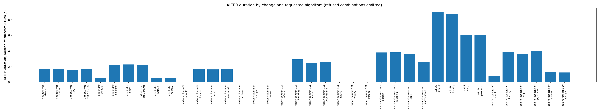
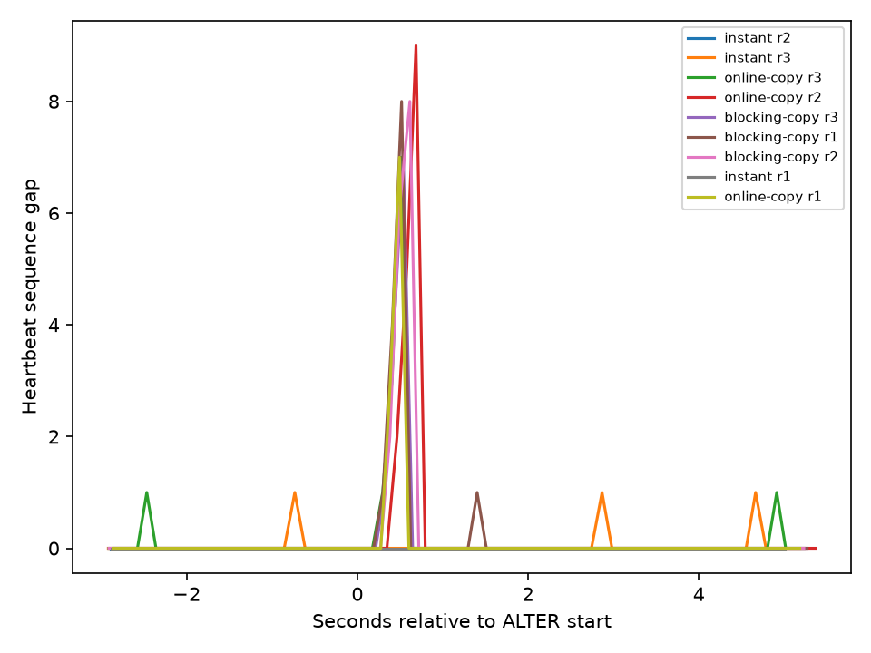

A project for area 8, "Online schema change, without external tools" for the MariaDB student database projects, 2026-09.

# MyLYMB — MariaDB online DDL laboratory

**Recommendation:** Request INSTANT first when supported, then NOCOPY or INPLACE with LOCK=NONE; use COPY with LOCK=NONE when a rebuild is required. Explicit requests prevent silent fallback to a more expensive algorithm. Online does not mean free of metadata locks, I/O costs or replica delay.

## Results at a glance

MariaDB 11.4.13, one million seeded rows, seven changes × seven configurations × five repetitions: **245 requests, 190 successes, 55 expected error-1846 refusals, zero unexpected ALTER failures.** Four workload statements failed in a blocking foreign-key run; DDL success is not application success.

| Change | First request | Five durations (s) | Median (s) | SD (s) |
|---|---|---|---:|---:|
| widen-column-60 | INSTANT | 0.030, 0.022, 0.041, 0.045, 0.043 | 0.041 | 0.010 |
| widen-column-100 | INSTANT | 0.042, 0.033, 0.040, 0.034, 0.037 | 0.037 | 0.004 |
| add-index | NOCOPY | 0.536, 0.559, 0.532, 0.522, 0.530 | 0.532 | 0.014 |
| change-type | COPY / NONE | 6.858, 1.577, 1.591, 1.599, 1.658 | 1.599 | 2.349 |
| widen-column-rebuild | COPY / NONE | 3.756, 3.917, 2.463, 2.497, 3.654 | 3.654 | 0.716 |
| add-fk | COPY / NONE | 6.198, 6.003, 5.964, 6.012, 6.161 | 6.012 | 0.105 |
| add-fk-fkchecks-off | NOCOPY (checks off) | 0.754, 1.345, 0.770, 1.255, 1.335 | 1.255 | 0.303 |

[All 245 raw ALTER records](results/final_20261124_195223/alter_results.csv) · [Classified results](results/final_20261124_195223/analysis/classified_alter_results.csv) · [Statistics](results/final_20261124_195223/repeated_statistics.csv) · [Workload by phase](results/final_20261124_195223/analysis/workload_by_phase.csv) · [Configuration](results/final_20261124_195223/sweep_config.txt) · [Environment](results/final_20261124_195223/environment.json).



Compatible widening to 60 and 100 was about 40× and 66× faster by median with INSTANT than explicit online COPY (1.651 and 2.443 s). This is a duration comparison, not proof of zero blocking. For DATE → DATETIME, 3,196 successful statements overlapped online COPY versus 31 for exclusive COPY across five runs. Overlap includes statements spanning the ALTER boundary, not necessarily completed during it. Four INSERTs failed in one blocking foreign-key run. Short windows with fewer than 30 samples do not support reliable tail percentiles. Online COPY also showed waits in some index and widening runs.


**Version matters:** `ALGORITHM=COPY, LOCK=NONE` exists only from MariaDB 11.2. In our earlier validation run on MariaDB 10.11 it was refused in every case with error 1846 ([10.11 run](results/validation_sandbox_mariadb10.11/)); on 11.4.13 it succeeded for all seven changes.

### Full comparison: every change × every algorithm

ALTER duration in seconds, median of five runs (`refused` = error 1846, nothing was changed). Generated with `python make_readme_tables.py results/final_20261124_195223`.

| Change | default | blocking | copy | copy-shared | inplace | nocopy | instant |
|---|---|---|---|---|---|---|---|
| change-type | 1.73 | 1.69 | 1.60 | 1.67 | refused | refused | refused |
| add-index | 0.55 | 2.22 | 2.27 | 2.24 | 0.54 | 0.53 | refused |
| widen-column-60 | 0.01 | 1.72 | 1.65 | 1.71 | 0.02 | 0.02 | 0.04 |
| widen-column-100 | 0.03 | 2.92 | 2.44 | 2.55 | 0.03 | 0.03 | 0.04 |
| widen-column-rebuild | 3.81 | 3.83 | 3.65 | 2.64 | refused | refused | refused |
| add-fk | 9.02 | 8.75 | 6.01 | 6.05 | refused | refused | refused |
| add-fk-fkchecks-off | 0.81 | 3.91 | 3.63 | 4.03 | 1.35 | 1.25 | refused |

Column meaning: `blocking` = `ALGORITHM=COPY, LOCK=EXCLUSIVE`; `copy` = `ALGORITHM=COPY, LOCK=NONE`; `copy-shared` = `ALGORITHM=COPY, LOCK=SHARED`; `default` = no clause (MariaDB chooses).

### Did writes keep flowing? Worst write wait during the ALTER

This is the core result. Median over five runs of each run's slowest concurrent write, in ms (successful ALTERs only); in parentheses, workload statements that overlapped the ALTER across all five runs. Source: [workload by phase](results/final_20261124_195223/analysis/workload_by_phase.csv), phase `during`.

| Change | default | blocking | copy | copy-shared | inplace | nocopy | instant |
|---|---|---|---|---|---|---|---|
| change-type | 33 (3262) | 1677 (31) | 37 (3196) | 1672 (33) | - | - | - |
| add-index | 20 (1099) | 2204 (40) | 36 (4575) | 2221 (23) | 10 (1222) | 17 (1115) | - |
| widen-column-60 | 9 (10) | 1711 (29) | 25 (3324) | 1706 (21) | 6 (32) | 4 (38) | 12 (81) |
| widen-column-100 | 13 (61) | 2915 (40) | 21 (4836) | 2547 (40) | 13 (71) | 14 (70) | 13 (64) |
| widen-column-rebuild | 24 (6486) | 3815 (33) | 31 (6098) | 2638 (54) | - | - | - |
| add-fk | 32 (16136) | 8746 (37) | 24 (11659) | 6045 (36) | - | - | - |
| add-fk-fkchecks-off | 29 (1800) | 3918 (35) | 36 (6480) | 4036 (46) | 26 (2338) | 27 (2082) | - |

With a blocking lock (`blocking`, `copy-shared`) a write waited about as long as the whole ALTER: 1.7–8.7 s. With `LOCK=NONE` the worst write waited 4–37 ms, a 45–360× reduction, and thousands of statements completed during the ALTER instead of a few dozen. It is not free: write p95 rose from 4–6 ms at baseline to 8–25 ms during online COPY, and two single runs stood out (change-type 828 ms, add-index 389 ms; the sweep is not randomised, so cold caches are the likely cause).

Workload errors during the ALTER were 0 in every cell except `add-fk` / `blocking`: 4 INSERTs hit the 10 s `lock_wait_timeout` in one run.

**Progress column.** `max_progress_pct` in [alter_results.csv](results/final_20261124_195223/alter_results.csv) is the highest value of the `PROGRESS` column in `information_schema.PROCESSLIST` sampled every 250 ms. Copy-based ALTERs reach about 80–100 %; NOCOPY/INPLACE/INSTANT report 0 because they finish before a sample or do not report stage progress. Two runs record 9999.999, which is not a real percentage, so the column is only a rough progress indicator.

### What we'd run on a Friday

"Friday-safe" here means no concurrent write waited more than about a tenth of a second and no workload statement failed.

| Change | Write this (MariaDB 11.4) | Median ALTER | Worst write wait | Friday? |
|---|---|---:|---:|---|
| Widen `email_address` 30 → 60/100 chars | `ALGORITHM=INSTANT` | 0.04 s | 12–13 ms | ✅ yes |
| Add index on `username` | `ALGORITHM=NOCOPY, LOCK=NONE` | 0.53 s | 17 ms | ✅ yes |
| `birth_date` DATE → DATETIME | `ALGORITHM=COPY, LOCK=NONE` | 1.60 s | 37 ms | ✅ on 11.2+ only |
| Widen `first_name` 50 → 100 chars | `ALGORITHM=COPY, LOCK=NONE` | 3.65 s | 31 ms | ✅ on 11.2+ only |
| Add foreign key, checks ON | `ALGORITHM=COPY, LOCK=NONE` | 6.01 s | 24 ms | ✅ slowest, but every row is validated |
| Add foreign key, checks OFF | `SET SESSION foreign_key_checks=0;` then `ALGORITHM=NOCOPY, LOCK=NONE` | 1.25 s | 27 ms | ⚠️ only after you checked there are no orphan rows |
| Add a UNIQUE index, or narrow a column | `ALGORITHM=INPLACE` or `COPY, LOCK=NONE` | — | writers not stopped | ⚠️ check the data first: online DDL lets conflicting writes in, then fails at the end (see [probes](#what-happens-when-concurrent-writes-break-the-alter)) |

Copyable statements are in [examples/README.md](examples/README.md), for example:

```sql
ALTER TABLE user_table MODIFY email_address VARCHAR(60) NOT NULL, ALGORITHM=INSTANT, LOCK=NONE;
ALTER TABLE user_table ADD INDEX idx_username(username), ALGORITHM=NOCOPY, LOCK=NONE;
ALTER TABLE user_table MODIFY birth_date DATETIME NOT NULL, ALGORITHM=COPY, LOCK=NONE;
```

## Quick start

Requires Docker Compose with `up --wait` support, Python 3.10+, Bash (Git Bash or WSL on Windows). Use a disposable local database: the harness drops and recreates its tables. Do not point it at production.

```bash
python configure.py       # once: creates .env with a random root password
python -m venv .venv
source .venv/bin/activate # Git Bash on Windows: source .venv/Scripts/activate
bash demo.sh
```

The demo generates a local random password, installs dependencies, starts MariaDB 11.4.13 and runs a small repeated comparison. Existing database volumes keep their original password: if you ran the project before and get `Access denied for user 'root'`, run `docker compose down -v` then `docker compose up -d --wait` (this deletes only the test data in the container). Full benchmark: `bash benchmark.sh` (after demo); set ROWS=1000000 for a larger dataset. Results are written to a timestamped folder. Run `python -m pip install -r requirements-dev.txt` and `python -m pytest -q` for unit tests.

## Research question and method

Which ALTER algorithms preserve concurrent write availability, what do they cost, and when does MariaDB refuse them? The sweep resets the schema and seeded data (random seed 42), starts writers, observes a workload-only baseline, executes ALTER, then observes recovery. It records individual statements, DDL timing, error codes and processlist samples. The full preset uses five repetitions, four writers and a fixed interval. Record machine and Docker resource limits alongside results; do not generalize one machine to production. See [methodology](docs/methodology.md) and [experiment catalogue](docs/experiments.md).

## Architecture and schema

`reset_db.py` loads `schema.sql` and `generate_data.py`; `workload.py` generates concurrent writes; `run_alter.py` uses the allowlisted registry in `experiments.py`; `sweep.sh` orchestrates runs; `analyze_results.py` produces charts and classifies outcomes.

Schema ([schema.sql](schema.sql)). Both tables use InnoDB, because online DDL is an InnoDB feature, and utf8mb4, so a VARCHAR(n) can hold up to 4·n bytes:

| Table | Columns | Why it is shaped this way |
|---|---|---|
| `user_table` (1,000,000 rows) | `id` INT PK, `first_name` VARCHAR(50), `middle_name` VARCHAR(50), `last_name` VARCHAR(50), `birth_date` DATE, `email_address` VARCHAR(30), `phone_number` VARCHAR(25), `country` VARCHAR(30), `username` VARCHAR(30), `created_at` DATETIME | `email_address` is 120 bytes, under the 128-byte line, so widening it can be INSTANT; `first_name` is 200 bytes, so widening it past 255 forces a rebuild. `birth_date` is DATE so DATE → DATETIME forces a copy. `username` has no index so adding one can be measured. |
| `orders` | `id` INT PK, `user_id` INT, `order_total` DECIMAL(10,2), `status` VARCHAR(20), `created_at` DATETIME | Starts **without a foreign key and without an index on `user_id`**. Adding the foreign key is itself one of the experiments, so it must not exist yet; and InnoDB needs an index on `user_id` for the key, so the experiment measures building both together. |

### What the server does underneath

Every ALTER takes the table's metadata lock (MDL) at the start, does its work, then takes a short exclusive MDL to swap in the new definition. The algorithm decides the middle part:

* **INSTANT** edits only the data dictionary; no row is read, so the time does not depend on table size. VARCHAR widening qualifies only if no stored length prefix changes (old maximum ≤ 127 bytes, or new maximum ≤ 255 bytes).
* **NOCOPY / INPLACE** work inside InnoDB's own files (for example building a new index tree) while concurrent changes go to an online log, replayed at the end. That log is capped by `innodb_online_alter_log_max_size`; if heavy writes overflow it, the ALTER fails at the end.
* **COPY** builds a new table row by row and renames it. With `LOCK=EXCLUSIVE` or `SHARED`, writers wait for the whole copy. **`LOCK=NONE` (MariaDB 11.2+)** copies from a snapshot while concurrent writes are captured in an online change buffer (a temporary file) and applied before the swap. This is the job `pt-online-schema-change` used to do with triggers. Constraints are checked when the buffered changes are applied, which is why a conflicting write makes the ALTER fail at the very end (see the probes below).
* **The shared trap is the MDL:** a long open transaction makes even INSTANT wait, and every new query queues behind it (our probe: error 1205 after 2 s).

## Why MariaDB and where it loses

MariaDB 11.2+ supports native online COPY for supported changes, avoiding external trigger-based migration machinery. Explicit algorithms let operators reject an unsupported migration rather than silently accept a rebuild. But COPY needs temporary space and I/O; metadata locks can delay even INSTANT, and replication can lag. Disabling foreign-key checks trades away existing-data validation. External migration systems may offer operational controls this lab does not evaluate.

The VARCHAR boundary is subtle: utf8mb4 VARCHAR(30) has a maximum of 120 bytes; VARCHAR(50) has 200. Widening to 400 bytes crosses the 255-byte storage boundary in both cases, but the original maximum below 128 bytes can permit INSTANT in cases where the 200-byte original cannot. Test the exact server and row format rather than assuming all widening is instant.

## Extended experiments and limitations

[Raw advanced results](results/final_20261124_195223/advanced.csv) contain 30 probes, three repetitions each. For utf8mb4 VARCHAR widening to 100, starting lengths 30, 31 and 64 succeeded every time; 32, 50 and 63 were refused every time. This isolates the 128-byte original-length threshold and the 255-byte storage boundary.

An open transaction caused INSTANT to time out (error 1205) in 2.0182, 2.0155 and 2.0196 s; after release it succeeded in 22.6, 21.2 and 24.7 ms. This probe measures DDL waiting, not application downtime. With an orphan row, all three validated foreign-key additions failed (1452); all three unchecked additions succeeded and retained the orphan. Never disable validation solely for speed.

The benchmark ran on Windows 11, 20 logical CPUs, a 1 GiB InnoDB buffer pool, four writers, 10 ms configured interval, 10 s baseline and 5 s recovery. Post-benchmark inventory: Intel Core i7-13700H (14 cores, 20 threads), 15.73 GiB RAM, 1 TB SSD, Docker reporting 20 CPUs and 7.62 GiB RAM; Docker 29.8.0, Compose v5.5.1, Python 3.13.9. These limits were collected after the benchmark. The sweep is sequential rather than randomized; cache and background activity can influence timings (e.g. online type-change COPY ranged from 1.577 to 6.858 s). Results describe this one laptop and this workload only; no second machine repeated the 1M-row benchmark. Replication was measured separately at 100,000 rows (below).

## What happens when concurrent writes break the ALTER

MariaDB 11.4.13, 1,000,000 rows, three repetitions per case, same outcome every time ([raw probes](results/advanced_extra/advanced.csv)). A writer inserts rows into the table while the ALTER runs.

| Case | ALTER | Median time | Result | Writer |
|---|---|---:|---|---|
| UNIQUE index, writer inserts a duplicate | `ADD UNIQUE INDEX uq_v (v), ALGORITHM=INPLACE, LOCK=NONE` | 0.42 s | ❌ 1062 `Duplicate entry 'v1' for key 'uq_v'` | not stopped, 0 errors |
| same, online COPY | `... ALGORITHM=COPY, LOCK=NONE` | 1.06 s | ❌ 1062 | not stopped, 0 errors |
| UNIQUE index, no duplicates (control) | `... ALGORITHM=INPLACE, LOCK=NONE` | 0.42 s | ✅ index created | 0 errors |
| Narrow VARCHAR(30) → (10), writer inserts long values | `MODIFY v VARCHAR(10) NOT NULL, ALGORITHM=COPY, LOCK=NONE` | 0.66 s | ❌ 1265 `Data truncated for column 'v' at row 1000001` | not stopped, 0 errors |
| same, writer inserts short values (control) | same | 0.67 s | ✅ column narrowed | 0 errors |
| KILL during online COPY | `MODIFY v VARCHAR(40) ..., ALGORITHM=COPY, LOCK=NONE` | 0.21 s | stopped 3–4 ms after KILL, table unchanged | — |

What this shows: online DDL does not stop conflicting writes. It accepts them, does the whole rebuild, and only fails when it applies them at the end. The row number in the 1265 error (1000001, the first row after the 1,000,000 seeded ones) shows the failure came from a row the writer inserted *during* the ALTER. A failed ALTER costs as much time as a successful one (0.42 vs 0.42 s, 0.66 vs 0.67 s), and nothing is changed. KILL is a clean way out. So: check the data before adding a UNIQUE index or narrowing a column, and expect to lose the whole rebuild time if a writer slips in a conflict. Limit: the writers inserted only a few dozen rows per run (25–69), because the ALTERs last about a second; nothing here says how this behaves under heavy load.

## Measured replication impact (100,000 rows)

The same VARCHAR(30) → VARCHAR(60) change was tested on MariaDB 11.4.13 with one primary, one replica, one concurrent writer and three repetitions per configuration in a fixed shuffled order. All nine runs completed; row counts, ordered SHA-256 digests, table definitions and final heartbeat matched after catch-up. All sampled replication threads were running with zero reported I/O or SQL error codes.

| Configuration | ALTER times (ms, repeats 1–3) | Median (ms) | Sample SD (ms) | Peak sequence gap | Peak heartbeat age (ms) | Worst overlapping write (ms) |
|---|---|---:|---:|---:|---:|---:|
| instant | 23.0, 22.4, 24.9 | 23.0 | 1.3 | 1 | 126.8 | 17.1 |
| online-copy | 285.7, 375.6, 271.3 | 285.7 | 56.5 | 9 | 373.3 | 33.6 |
| blocking-copy | 271.1, 317.9, 308.5 | 308.5 | 24.7 | 8 | 613.3 | 293.2 |

INSTANT had a 12.4× shorter median duration than online COPY. Online COPY reduced the worst observed overlapping write latency by 88.5% versus exclusive COPY, yet its sampled sequence gap reached nine transactions. Primary write availability therefore does not guarantee replica freshness. Blocking COPY had the highest heartbeat age, but not the highest sequence gap. Heartbeat age includes primary stalls and heartbeat pacing; sequential reads can overestimate the gap, and the approximately 100 ms sampler can miss short events. Only three repeats, one writer and shared local hardware were tested; these results are not production latency guarantees.

[Individual replication runs](results/replication_20261125_111030/replication_results.csv) · [Summary](results/replication_20261125_111030/replication_summary.csv) · [Methodology](docs/replication_protocol.md)



## Team


| Area | Owner | Main files | Original research items |
|---|---|---|---|
| Infrastructure, progress polling, widen-column | Bashah | `docker-compose.yml`, `schema.sql`, `generate_data.py`, processlist polling in `run_alter.py`, `widen-column-*` | Does INSTANT/NOCOPY work for widening a VARCHAR? |
| `workload.py`, add-index | Leyla | `workload.py`, `add-index` | Does adding an index support NOCOPY; how does it differ from INPLACE? |
| `run_alter.py` skeleton, change-type | Mirqe | `run_alter.py`, `experiments.py`, `change-type` | Widening/changing types (DATE → DATETIME tested) |
| README, sweep script, add-fk | Yasmine | `README.md`, `sweep.sh`, `tests/add-fk/`, `add-fk*` | Does MariaDB support INPLACE/NOCOPY for a foreign key, or force COPY? |


## Further reading

[MariaDB ALTER TABLE](https://mariadb.com/docs/server/reference/sql-statements/data-definition/alter/alter-table) · [Area assignment](https://mariadb.org/bachelor_hackathon_2026-09/)

### Replication extension

Run `bash replication_benchmark.sh` for a separate primary/replica experiment (100,000 rows, three repetitions per configuration). See [replication methodology](docs/replication_protocol.md). The nine measured runs are linked above. Existing million-row results need not be rerun.
