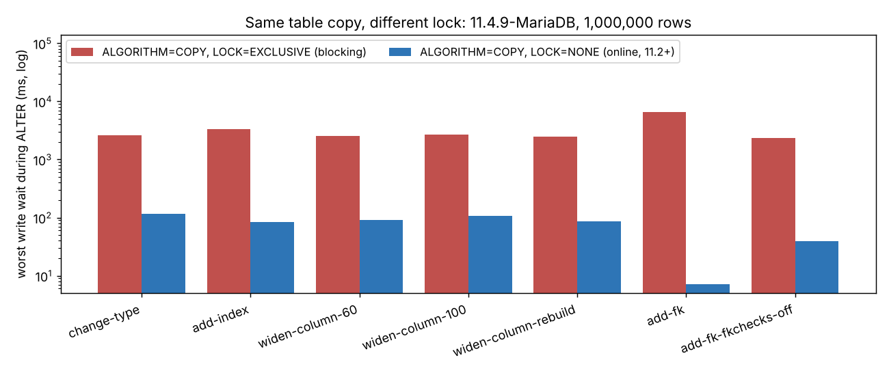

A project for area 8, "Online schema change, without external tools" for the [MariaDB student database projects, 2026-09](https://mariadb.org/bachelor_hackathon_2026-09/).

# MyLYMB: a migration laboratory for MariaDB online DDL


**MariaDB version: 11.4** (developed and benchmarked against the pinned `mariadb:11.4` image). Version matters
here: `ALGORITHM=COPY, LOCK=NONE`, the feature this area is about, exists only from **MariaDB 11.2**. On 10.11
every such request is refused with error 1846 (see [14.3](#144-pipeline-validation-run-mariadb-101114-where-copy-locknone-does-not-exist)).

> **Status (2026-11-16).** Team-reported MariaDB 11.4.13 runs include a 1,000-row
> compatibility smoke test (42 cases) and a **100,000-row repeated benchmark**
> (126 ALTER requests, 102 successes, 24 expected error-1846 rejections).
> [The 100k results](results/sweep_20261116_145509_console/README.md) are
> transcribed from the supplied terminal output. The original 126-run workload CSVs
> were not provided; a separate focused 8-run workload dataset is now included,
> but its short ALTER windows limit latency conclusions.
> MariaDB 10.11.14 sandbox measurements remain historical and separately labeled.

**In one sentence:** we put a large InnoDB table under a continuous INSERT/UPDATE/DELETE workload, run four kinds
of schema change with every algorithm MariaDB offers, and measure how long each ALTER takes, how long the
concurrent writes wait, and which combinations MariaDB refuses. Answer in [15. Findings](#15-findings) and in the
[Friday table](#83-what-wed-run-on-a-friday).

## Contents

1. [Project Overview](#1-project-overview) · 2. [Research Question](#2-research-question) · 3. [Objectives](#3-objectives) · 4. [Technologies](#4-technologies) · 5. [Architecture](#5-architecture) · 6. [Database Schema](#6-database-schema) · 7. [Experiments](#7-experiments) · 8. [Algorithms](#8-algorithms) ([8.2 Underneath](#82-what-the-server-does-underneath), [8.3 Friday table](#83-what-wed-run-on-a-friday)) · 9. [Workload](#9-workload) · 10. [Methodology](#10-methodology) · 11. [Installation](#11-installation) · 12. [Quick Start](#12-quick-start) · 13. [Running the Benchmark](#13-running-the-benchmark) · 14. [Results](#14-results) · 15. [Findings](#15-findings) · 16. [Limitations](#16-limitations) · 17. [Reproducibility](#17-reproducibility) · 18. [Team](#18-team) · 19. [Project Structure](#19-project-structure) · 20. [Lessons Learned](#20-lessons-learned) · 21. [Conclusion](#21-conclusion)

## Latest MariaDB 11.4 evidence and Windows Git Bash notes

* [11.4.13 repeated 100k-row results (126 console-observed runs)](results/sweep_20261116_145509_console/README.md), [CSV summary](results/sweep_20261116_145509_console/console_alter_summary.csv), and [chart](results/sweep_20261116_145509_console/console_duration_comparison.png).
* [11.4.13 initial 1k-row smoke-test observations](docs/11_4_results_and_next_steps.md).
* For Windows Git Bash: `source .venv/Scripts/activate`, then `bash sweep.sh --rows 1000 --repeats 1`. The runner now uses the active virtual environment by default; `PYTHON=python bash sweep.sh ...` is also supported.
* `analysis/classified_alter_results.csv` distinguishes **successful ALTER**, **expected error 1846**, and **unexpected failure** without altering the raw CSV. A rejected algorithm is not a successful migration.
* For a research-grade comparison, use `bash sweep.sh --rows 100000 --repeats 3`, record machine specifications, and inspect the workload latency sample counts before drawing conclusions.

## 1. Project Overview

Changing a table's structure on a live database is risky: a plain `ALTER TABLE` can rebuild the table and
block every writer for as long as it takes. MariaDB advertises native *online DDL*: several algorithms
(`COPY`, `INPLACE`, `NOCOPY`, `INSTANT`) and lock levels (`LOCK=NONE/SHARED/EXCLUSIVE`) that should let a
table be altered while it is still being written to, without external tools such as `pt-online-schema-change`.

This project builds a small **migration laboratory** to test that claim with measurements: a populated
table, a continuous INSERT/UPDATE/DELETE workload, four families of schema change, each requested with
every algorithm, recording what MariaDB accepts, how long it takes, and what happens to the concurrent writes.

## 2. Research Question

> How do the MariaDB 11.4 online schema-change algorithms affect the execution time of `ALTER TABLE`
> and the latency and error rate of concurrent INSERT, UPDATE and DELETE statements, and which
> algorithm/operation combinations are actually supported?

## 3. Objectives

* **Measure** ALTER duration and per-operation workload latency (p50, p95, p99, max, errors).
* **Compare** a baseline (workload only) with the ALTER window, per algorithm and per change.
* **Observe** which combinations MariaDB refuses, with the exact error code and message.
* **Analyse** the effect of dataset size and of `foreign_key_checks` on adding a foreign key.
* **Understand** *why* an operation is or is not online, using MariaDB's own error messages and `Progress` column.

## 4. Technologies

MariaDB 11.4 (Docker image `mariadb:11.4`, pinned) · Docker Compose · Python 3.10+ with PyMySQL ·
SQL · Bash (`sweep.sh`) · CSV · pandas, numpy, matplotlib (analysis and figures).

## 5. Architecture

```text
Docker (docker-compose.yml)
  └─ MariaDB 11.4 ── schemalab ── user_table, orders
        ▲  reset_db.py = schema.sql + generate_data.py   (identical state before every run)
        │
        ├── workload.py   background INSERT/UPDATE/DELETE, one CSV row per statement
        ├── run_alter.py  one ALTER (+ session config), timed, processlist polled, one CSV row
        │        ▲
        │        └── experiments.py   registry of changes and algorithms
        └── sweep.sh      orchestrates: reset → workload → baseline → ALTER → after → stop, for every combination
                ▼
        results/<sweep_id>/*.csv ── analyze_results.py ──► analysis/*.csv, summary.md, *.png
```

## 6. Database Schema

Defined in [`schema.sql`](schema.sql) (re-runnable: it drops and recreates both tables). Both tables
deliberately start **without** secondary index and **without** foreign key; two experiments add them.

| Table | Columns | Role |
|---|---|---|
| `user_table` | `id` PK, `first_name` VARCHAR(50), `middle_name` VARCHAR(50) NULL, `last_name` VARCHAR(50), `birth_date` DATE, `email_address` VARCHAR(30), `phone_number` VARCHAR(25), `country` VARCHAR(30), `username` VARCHAR(30), `created_at` DATETIME | Target of change-type, add-index, widen-column; parent table of the FK |
| `orders` | `id` PK, `user_id` INT, `order_total` DECIMAL(10,2), `status` VARCHAR(20), `created_at` DATETIME | Child table of add-fk (`user_id` → `user_table.id`) |

Engine InnoDB (required: the online-DDL algorithms are InnoDB features), charset `utf8mb4`
(4 bytes per character, which matters for VARCHAR widening). The `orders` schema is this project's own
design: it was missing from the original repository.

## 7. Experiments

Defined in [`experiments.py`](experiments.py); details in [`docs/experiments.md`](docs/experiments.md).

| Experiment | Table | SQL | Description |
|---|---|---|---|
| `change-type` | user_table | `MODIFY COLUMN birth_date DATETIME NOT NULL` | DATE → DATETIME: the storage format changes. |
| `add-index` | user_table | `ADD INDEX idx_username (username)` | Secondary index on a near-unique column. |
| `widen-column-60` | user_table | `MODIFY COLUMN email_address VARCHAR(60) NOT NULL` | 30 → 60 characters (120 → 240 bytes, stays below 255). |
| `widen-column-100` | user_table | `MODIFY COLUMN email_address VARCHAR(100) NOT NULL` | 30 → 100 characters (120 → 400 bytes, crosses 255, but the old maximum is ≤ 127 bytes). |
| `widen-column-rebuild` | user_table | `MODIFY COLUMN first_name VARCHAR(100) NOT NULL` | 50 → 100 characters (200 → 400 bytes): old maximum between 128 and 255 bytes, so INSTANT is impossible ([why](#82-what-the-server-does-underneath)). |
| `add-fk` | orders | `ADD CONSTRAINT fk_orders_user FOREIGN KEY (user_id) REFERENCES user_table (id)` | `foreign_key_checks` ON (MariaDB default). |
| `add-fk-fkchecks-off` | orders | same | Same ALTER after `SET SESSION foreign_key_checks=0` on the ALTER's connection. |

`foreign_key_checks` is a **session setting, not an algorithm**; that is why add-fk with checks off is a
separate *change* (recorded in the `session_config` CSV column) and not an algorithm called "inplace-checksoff".
Manual SQL versions of the add-fk scenarios are in [`tests/add-fk/`](tests/add-fk/README.md).

## 8. Algorithms

### 8.1 Requested clauses

Each change is requested with every algorithm below (`python run_alter.py --list`).

| Name | Clause appended to the ALTER | Meaning |
|---|---|---|
| `default` | *(none)* | The server chooses algorithm and lock level (what a developer gets by default). |
| `blocking` | `ALGORITHM=COPY, LOCK=EXCLUSIVE` | Explicit offline baseline: table copy, no concurrent access. |
| `copy` | `ALGORITHM=COPY, LOCK=NONE` | Table copy *while writes continue* (online schema change, MariaDB ≥ 11.2). Refused on 10.11. |
| `copy-shared` | `ALGORITHM=COPY, LOCK=SHARED` | Table copy; reads allowed, writes wait. |
| `inplace` | `ALGORITHM=INPLACE, LOCK=NONE` | In-place InnoDB change, concurrent DML allowed. |
| `nocopy` | `ALGORITHM=NOCOPY, LOCK=NONE` | Only if the table is not rebuilt, otherwise an error. |
| `instant` | `ALGORITHM=INSTANT` | Metadata-only change, otherwise an error. |

**Not every combination is supported.** An explicit `ALGORITHM=`/`LOCK=` is a demand: MariaDB fails with
error 1846 instead of silently falling back to something slower. Those failures are recorded as results
(`status=failure`, errno, message), not treated as bugs.

### 8.2 What the server does underneath

Every `ALTER TABLE` has the same three moments. What differs between algorithms is the middle one.

```text
 1. ENTER          2. WORK (the long part)                          3. COMMIT
 take the table's  INSTANT : edit the data dictionary only          short EXCLUSIVE metadata lock:
 metadata lock     NOCOPY  : change secondary structures, no         swap in the new definition
 (MDL)             INPLACE : InnoDB rebuilds/builds inside its own   (needs every open transaction
                             files, logging concurrent DML           on the table to finish first)
                   COPY    : build a new table row by row, rename it
```

* **`INSTANT`** touches no rows. Only the table definition changes, so the duration does not depend on the
  table size. Example: widening `email_address` from `VARCHAR(30)` (120 bytes in utf8mb4) to `VARCHAR(100)`.
  InnoDB stores a 1- or 2-byte length prefix per value. A column whose maximum is ≤ 127 bytes can be widened
  to any length instantly, because no existing value can be ≥ 128 bytes, so no stored length prefix changes.
  A column of 128 to 255 bytes cannot cross the 255-byte line instantly. That is why we added `widen-column-rebuild`
  (`first_name` 50 → 100 characters, 200 → 400 bytes).
* **`NOCOPY`** does not rebuild the clustered index (the table itself). Adding a secondary index qualifies: InnoDB
  scans the table, sorts the keys and builds the new index tree alongside.
* **`INPLACE, LOCK=NONE`** lets InnoDB do the work inside its own files while writes continue. Concurrent changes
  go to an *online alter log* (bounded by `innodb_online_alter_log_max_size`) and are replayed at the end.
  It cannot do everything: a `DATE → DATETIME` type change is refused, and so is adding a foreign key while
  `foreign_key_checks=1` (InnoDB would have to validate every existing row against the parent table).
* **`COPY`** is the generic path that works for every change: create `#sql-…` with the new definition, copy
  every row, rename. Under `LOCK=SHARED` or `LOCK=EXCLUSIVE` writers wait for the *whole* copy.
  **`COPY, LOCK=NONE` (MariaDB ≥ 11.2)** adds an *online change buffer*: the copy reads a `REPEATABLE READ`
  snapshot of the old table while concurrent INSERT/UPDATE/DELETE keep going to the old table and are
  duplicated into a per-table temporary file. When the copy has caught up, the buffered changes are applied
  to the new table, then a short exclusive lock swaps them. This is the same idea as `pt-online-schema-change`,
  done inside the server, with no triggers and no extra tool.
  Limits that matter here: the buffer lives in `TMPDIR` with no size cap (heavy writes can fill the disk, and
  there is no status variable to watch it). Tables with `ON DELETE/UPDATE CASCADE / SET NULL / SET DEFAULT`
  foreign keys cannot use it. Constraints, foreign keys included, are checked for every buffered change.
* **`default`** (no clause): MariaDB picks the cheapest algorithm that works (INSTANT → NOCOPY → INPLACE → COPY).
  From 11.2 the copy fallback is itself online (`LOCK=NONE`) unless `old_mode=LOCK_ALTER_TABLE_COPY` is set.
  That is the single biggest behaviour change between our 10.11 validation run and 11.4.
* **The trap every algorithm shares: the metadata lock.** Steps 1 and 3 need the table's MDL. A long-running
  transaction that touched the table (even a forgotten `SELECT` in an open transaction) makes the ALTER wait
  in `Waiting for table metadata lock`. **Every new query on that table then queues behind the ALTER.** An
  "instant" change can freeze the application this way. That is why our workload uses autocommit and a 10 s
  `lock_wait_timeout`, and why `run_alter.py` polls the processlist for sessions in a `Waiting for …` state.

Sources: [Online Schema Change (MariaDB docs)](https://mariadb.com/docs/server/reference/sql-statements/data-definition/alter/alter-table/online-schema-change),
[InnoDB INSTANT operations](https://mariadb.com/kb/en/innodb-online-ddl-operations-with-the-instant-alter-algorithm/),
[MariaDB Hidden Gem: Online Schema Change without pt-osc](https://mariadb.org/mariadb-hidden-gem-online-schema-change-without-pt-osc/).

### 8.3 What we'd run on a Friday

"Friday-safe" here means **no concurrent write in our workload waited more than about a tenth of a second, and
no statement failed**, so an application would not notice. The last column shows what the same change costs the
writers if you let it take a blocking lock.

| Change | Write this (MariaDB 11.4) | Online? | ALTER (s) | Worst write wait (ms) | Worst write wait, blocking COPY | Friday? |
|---|---|---|---|---|---|---|
| widen `email_address` 30 → 60 / 100 chars | `ALGORITHM=INSTANT` | metadata only | 0.00 | none overlapped | 2.5 s | ✅ yes |
| add index on `username` | `ALGORITHM=NOCOPY, LOCK=NONE` | builds index alongside | 0.68 | 27 | 3.3 s | ✅ yes |
| change type `DATE → DATETIME` | `ALGORITHM=COPY, LOCK=NONE` | online copy (11.2+) | 3.30 | 117 | 2.6 s | ✅ on 11.4 · ❌ on 10.11 |
| widen `first_name` 50 → 100 chars (rebuild) | `ALGORITHM=COPY, LOCK=NONE` | online copy (11.2+) | 2.25 | 86 | 2.5 s | ✅ on 11.4 · ❌ on 10.11 |
| add foreign key, checks ON | `ALGORITHM=COPY, LOCK=NONE` | online copy, every row validated | 7.22 | 7 | 6.6 s | ✅ but slowest |
| add foreign key, checks OFF | `SET foreign_key_checks=0;` then `ALGORITHM=NOCOPY, LOCK=NONE` | no copy, no validation | 0.93 | 10 | 2.3 s | ⚠️ only after you have checked there are no orphan rows |

Numbers: MariaDB 11.4.9, 1,000,000 rows, 2 writer threads, 1 repetition ([14.3](#143-separately-supplied-cross-check-dataset-mariadb-1149-1000000-rows)).
A future 3-repetition Docker benchmark would provide a stronger comparison.

**Rules of thumb we'd hand to an on-call engineer:**

1. **Always write the clause.** Ask for `ALGORITHM=INSTANT` (or `NOCOPY`/`INPLACE`, `LOCK=NONE`). If MariaDB
   cannot honour it, it fails with error 1846 *before touching anything*, so you lose nothing and learn the reason.
2. **If only COPY works, write `ALGORITHM=COPY, LOCK=NONE` explicitly** (11.2+). Never accept a silent `LOCK=SHARED`.
3. **Check for long transactions first** (`SELECT * FROM information_schema.INNODB_TRX`), because the metadata lock
   is what freezes applications, not the algorithm.
4. **Watch free space in `TMPDIR`** during a `COPY, LOCK=NONE` on a busy table.

## 9. Workload

[`workload.py`](workload.py) runs `--threads` client connections (autocommit). Each thread loops:

| Step | Statement | Target row |
|---|---|---|
| INSERT | one new row (`user_table`, or `orders` with `--profile orders`) | new |
| UPDATE | `SET country=...` (or `SET status=...`) | random row this thread inserted, **by primary key** |
| DELETE | `DELETE ... WHERE id=?` | oldest row this thread inserted, once more than `--backlog` (50) exist |

Every statement is timed with `time.perf_counter()` and written to CSV: `timestamp_utc` (statement start),
`thread`, `operation`, `latency_ms`, `status`, `errno`, `error`, `rows_affected`. Design choices:
primary-key access (a scan would measure table size, not the ALTER), threads never touch the same rows
or the generated dataset, `lock_wait_timeout` = 10 s so blocked statements end as measurable errors,
automatic reconnection, UTC timestamps identical to `run_alter.py`. It stops on SIGINT/SIGTERM or `--duration`.

## 10. Methodology

Every run (one change × one algorithm) is executed by `sweep.sh` exactly like this:

```text
RESET (schema.sql + generate_data.py, seed 42, ANALYZE)   ← identical start state every time
  → start workload in background, wait until connected
  → baseline phase (workload only, default 10 s)
  → ALTER on its own connection  [processlist polled every 250 ms: Progress, waiting sessions]
  → after phase (default 5 s)
  → stop workload (SIGTERM), save CSVs
  → next run starts from RESET again
```

`analyze_results.py` assigns each workload statement to *baseline* (finished before the ALTER),
*during* (overlaps the ALTER window, including statements blocked by it) or *after*, then computes
count, errors, average, p50, p95, p99 and max per operation and phase. Phases with fewer than 30 statements
are flagged `low_sample`. Full description and threats to validity: [`docs/methodology.md`](docs/methodology.md).

## 11. Installation

Requirements: Docker (Desktop on Windows/macOS), Python 3.10+, Bash (Git Bash or WSL on Windows, for `sweep.sh`).

```bash
git clone <repository-url> && cd MyLYMB_database_project
pip install -r requirements.txt
cp .env.example .env          # optional: every value has a default
docker compose up -d          # MariaDB 11.4, bound to 127.0.0.1 only
docker compose ps             # wait until the container is "healthy"
```

The password defaults to `labpass` (local throw-away container, published on localhost only; never reuse it).
Change it in `.env` **before the first `docker compose up`**: the root password is fixed when the data volume
is created (to apply a new one: `docker compose down -v`, which deletes the lab data). `INNODB_BUFFER_POOL_SIZE`
(default 1G) influences ALTER durations; lower it on machines with little RAM and keep it identical across runs.

## 12. Quick Start

```bash
docker compose up -d && pip install -r requirements.txt
python reset_db.py --rows 100000 --change add-fk      # schema + 100k users + 100k orders
python run_alter.py --list                            # available changes and algorithms
./sweep.sh --rows 100000 --changes "add-index" --algorithms "default inplace" \
           --baseline-secs 3 --after-secs 2           # 2 runs, under a minute
```

The results appear in `results/sweep_<timestamp>/` (raw CSVs) and `.../analysis/` (summary, figures).

## 13. Running the Benchmark

**Full matrix** (7 changes × 7 algorithms = 49 runs per repetition; runtime is dominated by the reset, roughly
15 s per run at 200,000 rows and more at 1,000,000):

```bash
./sweep.sh --rows 1000000 --repeats 3 --threads 2
./sweep.sh --help                                      # all options
python analyze_results.py results/<sweep_id>           # re-run the analysis only
```

**One run by hand** (three terminals or background jobs):

```bash
python reset_db.py --rows 1000000 --change add-index
python workload.py --out results/wl_add-index_inplace.csv --threads 2 &   # terminal 1
python run_alter.py --change add-index --algorithm inplace \
       --out results/alter_results.csv --workload results/wl_add-index_inplace.csv       # terminal 2
kill -TERM %1                                                            # stop the workload
```

Datasets on their own: `python generate_data.py --rows 100000` (or 500000, 1000000; add `--truncate` if the
table is not empty). Generation streams in batches of 5,000 rows; 1,000,000 rows took 32 s with 36 MB of
memory in the validation environment.

### 13.1 Tests and pre-flight checks

Install test dependencies with `python -m pip install -r requirements-dev.txt`, then run
`python -m pytest -q tests/test_workload.py`. These tests use fake database connections:
they verify that both profiles target their own tables, failed SQL records the MariaDB
error number, successful statements log row counts, and disconnects are handled.

Before the full sweep, rehearse a small sweep (requires a running Docker MariaDB):

```bash
./sweep.sh --rows 1000 --repeats 1 --changes "add-index add-fk" --algorithms "default inplace" --baseline-secs 2 --after-secs 2
```

For the medium backup sweep (Git Bash / WSL):

```bash
./sweep.sh --rows 200000 --repeats 1
```

To check statement starts *during* each ALTER (rather than counting baseline/after
statements), run `python check_workload.py results/<sweep_id> --min-statements 1`.
A `LOW` result means the overlap was below the threshold or the workload CSV was
missing. Fast ALTERs may legitimately have zero overlapping statement starts;
inspect their duration and the workload CSV before treating this as a workload failure.
The checker returns exit code 1 for LOW results, 2 for invalid input.

## 14. Results

### 14.1 MariaDB 11.4.13: team-run repeated benchmark (100,000 rows)

The team supplied the full terminal transcript of `PYTHON=python bash sweep.sh --rows 100000 --repeats 3`:
**126 runs, 102 successes, 24 expected error-1846 rejections, no unexpected DDL failures**.
Three repetitions were completed for each of the 42 change/algorithm combinations.

[Full evidence, caveats and findings](results/sweep_20261116_145509_console/README.md) ·
[126 transcribed runs](results/sweep_20261116_145509_console/console_alter_runs.csv) ·
[42-row statistical summary](results/sweep_20261116_145509_console/console_alter_summary.csv) ·
[DDL timing chart](results/sweep_20261116_145509_console/console_duration_comparison.png).

| Change | INSTANT mean | NOCOPY mean | COPY mean |
|---|---:|---:|---:|
| Widen VARCHAR to 60 | 0.0277 s | 0.0303 s | 0.4313 s |
| Widen VARCHAR to 100 | 0.0267 s | 0.0360 s | 0.4117 s |
| Add index | refused (1846) | 0.1280 s | 0.4623 s |
| Add FK, checks OFF | refused (1846) | 0.1320 s | 0.5567 s |

**Evidence boundary:** These are console-derived DDL timings, **not** the original workload traces.
The user must add the generated `workload_*.csv` files before claiming nonblocking writes,
concurrent-write p95, throughput or error rates for this 11.4 run. Hardware specifications
and Docker limits are not yet recorded.



*Each pair of bars is the same table copy. Only the lock level differs. With `LOCK=EXCLUSIVE` a concurrent write
waits as long as the whole ALTER (2.3–6.6 s). With `LOCK=NONE` the worst write waited 7–117 ms.*

### 14.1a Focused 11.4.13 concurrent-write check (100,000 rows, 8 runs)

[Raw results](results/sweep_20261116_160234/) · [workload by phase](results/sweep_20261116_160234/analysis/workload_by_phase.csv) · [analysis summary](results/sweep_20261116_160234/analysis/summary.md) · [workload p95 figure](results/sweep_20261116_160234/analysis/fig_workload_p95.png).

This separately run focused sweep tested `add-index` and `widen-column-60` with COPY, INPLACE, NOCOPY and INSTANT (one repetition each). Seven ALTERs succeeded; `add-index` with INSTANT was rejected as expected (error 1846); no unexpected ALTER failures. COPY versus NOCOPY took 0.518 s versus 0.097 s for add-index, and 0.641 s versus 0.029 s for widening. These are **single-run** comparisons. Workload CSVs include baseline, during and after phases, but most during-ALTER operation groups have fewer than 30 statements; p95 estimates for these groups are not reliable. This is evidence of overlapping writes, not proof of zero metadata-lock impact or a statistically robust latency advantage.

### 14.2 Proposed primary benchmark (not yet run)

**Not yet run:** run `./sweep.sh --rows 1000000 --repeats 3 --threads 2 --sweep-id primary_11_4` (the id in `docs/evaluation_action_plan.md`),
then paste the output of `python make_readme_tables.py results/primary_11_4` here and record the machine
(CPU, RAM, Docker memory limit).

### 14.3 Separately supplied cross-check dataset (MariaDB 11.4.9, 1,000,000 rows)

Separately supplied dataset (not reproduced in this environment): full matrix, 7 changes × 7 algorithms, one repetition. MariaDB **11.4.9** compiled from source on a 2-vCPU / 8 GB
Linux VM (no Docker there), with **the same server options as `docker-compose.yml`** (utf8mb4, 1 GB buffer pool,
256 MB redo log). Settings: 1,000,000 rows, 2 workload threads, 5 s baseline, 3 s after.
Files: [`results/sandbox_mariadb11.4_1M/`](results/sandbox_mariadb11.4_1M/) (raw CSVs, `analysis/summary.md`, figures).

**ALTER duration, seconds** (median of 1 run(s); `refused` = MariaDB error, nothing altered)

| Change | default | blocking | copy | copy-shared | inplace | nocopy | instant |
|---|---|---|---|---|---|---|---|
| change-type | 2.69 | 2.66 | 3.30 | 2.75 | refused | refused | refused |
| add-index | 1.10 | 3.33 | 3.16 | 2.96 | 0.91 | 0.68 | refused |
| widen-column-60 | 0.00 | 2.51 | 2.38 | 2.50 | 0.01 | 0.01 | 0.00 |
| widen-column-100 | 0.01 | 2.73 | 2.33 | 2.51 | 0.00 | 0.01 | 0.01 |
| widen-column-rebuild | 2.47 | 2.52 | 2.25 | 2.61 | refused | refused | refused |
| add-fk | 6.43 | 6.57 | 7.22 | 7.20 | refused | refused | refused |
| add-fk-fkchecks-off | 0.87 | 2.36 | 2.08 | 2.65 | 0.81 | 0.93 | refused |

**Worst write latency while the ALTER ran, ms** (median over runs of the per-run maximum; in parentheses: workload statements overlapping the ALTER, all runs)

| Change | default | blocking | copy | copy-shared | inplace | nocopy | instant |
|---|---|---|---|---|---|---|---|
| change-type | 70 (216) | 2609 (2) | 117 (273) | 2752 (2) | - | - | - |
| add-index | 18 (112) | 3299 (2) | 83 (252) | 2910 (2) | 15 (90) | 27 (66) | - |
| widen-column-60 | - | 2516 (2) | 92 (180) | 2483 (2) | 2 (6) | 9 (2) | - |
| widen-column-100 | - | 2716 (2) | 107 (180) | 2478 (2) | - | 2 (1) | - |
| widen-column-rebuild | 80 (204) | 2500 (2) | 86 (180) | 2598 (2) | - | - | - |
| add-fk | 8 (702) | 6551 (2) | 7 (792) | 7193 (5) | - | - | - |
| add-fk-fkchecks-off | 12 (90) | 2321 (2) | 39 (201) | 2606 (2) | 17 (82) | 10 (96) | - |

Workload errors during every ALTER window: **0** (all 38 successful ALTERs). Refused: 11 of 49, all with error 1846.
Exact refusal reasons:

| Change | Refused | MariaDB's reason |
|---|---|---|
| change-type | inplace, nocopy, instant | `Cannot change column type. Try ALGORITHM=COPY` |
| widen-column-rebuild | inplace, nocopy, instant | `Cannot change column type. Try ALGORITHM=COPY` |
| add-index | instant | `ADD INDEX. Try ALGORITHM=NOCOPY` |
| add-fk | inplace, nocopy, instant | `Adding foreign keys needs foreign_key_checks=OFF. Try ALGORITHM=COPY` |
| add-fk-fkchecks-off | instant | `ADD INDEX. Try ALGORITHM=NOCOPY` (the FK needs an index on `user_id`) |

### 14.4 Pipeline validation run (MariaDB **10.11.14**, where `COPY, LOCK=NONE` does not exist)

The complete matrix was executed once to prove that the tooling works end to end. Conditions:
MariaDB 10.11.14 (Ubuntu package, no Docker), 256 MB buffer pool, 200,000 rows, 2 workload threads, 4 s baseline,
2 s after, 1 repetition, single machine. Files: [`results/validation_sandbox_mariadb10.11/`](results/validation_sandbox_mariadb10.11/)
(`alter_results.csv`, one workload CSV per run, processlist samples, `analysis/`).
**These are not the project's benchmark results**: other server version, tiny ALTER durations, one repetition.

ALTER duration in seconds (`refused` = MariaDB error 1846, nothing was altered):

| Change | default | blocking | copy | copy-shared | inplace | nocopy | instant |
|---|---|---|---|---|---|---|---|
| change-type | 0.85 | 0.88 | refused | 0.85 | refused | refused | refused |
| add-index | 0.28 | 0.96 | refused | 0.94 | 0.30 | 0.27 | refused |
| widen-column-60 | 0.04 | 0.77 | refused | 0.73 | 0.04 | 0.04 | 0.05 |
| widen-column-100 | 0.05 | 0.77 | refused | 0.96 | 0.04 | 0.04 | 0.05 |
| add-fk | 1.92 | 1.72 | refused | 1.92 | refused | refused | refused |
| add-fk-fkchecks-off | 0.35 | 0.76 | refused | 0.71 | 0.43 | 0.50 | refused |

Maximum latency (ms) of a workload statement overlapping the ALTER, with the number of such statements in
parentheses (successful ALTERs only). With only 1 to 6 statements in most cells, **percentiles are not meaningful here**
(`low_sample` in the CSV); the maximum is shown instead.

| Change | default | blocking | copy | copy-shared | inplace | nocopy | instant |
|---|---|---|---|---|---|---|---|
| change-type | 821 (2) | 863 (2) | - | 829 (2) | - | - | - |
| add-index | 16 (26) | 957 (2) | - | 921 (2) | 25 (27) | 23 (24) | - |
| widen-column-60 | 2 (1) | 730 (2) | - | 708 (4) | 33 (6) | 12 (2) | 30 (2) |
| widen-column-100 | 21 (2) | 723 (2) | - | 933 (6) | 9 (2) | 30 (4) | 36 (3) |
| add-fk | 1915 (4) | 1730 (3) | - | 1885 (2) | - | - | - |
| add-fk-fkchecks-off | 14 (35) | 781 (2) | - | 740 (2) | 12 (42) | 14 (51) | - |

Across this run: 28 ALTERs succeeded and 14 were refused (all with error 1846), and the workload logged **0 errors**
(ALTERs were shorter than the 10 s lock timeout). Figures: `analysis/fig_alter_duration.png`,
`fig_workload_p95.png`, `fig_latency_distribution.png`.

### 14.4 Historical / preliminary results (original repository)

Kept unchanged in [`results/historical/`](results/historical/). **Not comparable with the above and not a
benchmark**: the table was almost empty and the workload never ran at the same time as the ALTERs.

| File | Content |
|---|---|
| `results_alter_preliminary.csv` | 2 ALTERs on a near-empty table (`change-type`: blocking 0.321 s, copy 0.277 s; the second ran on an already-converted column). |
| `workload_baseline_preliminary.csv` | 477 statements over 19 s, no ALTER, 0 errors. Median INSERT 6.88 ms, UPDATE 4.31 ms, DELETE 3.93 ms. |

The historical `copy` row (`ALGORITHM=COPY, LOCK=NONE`, no error) **contradicted** the 10.11 sandbox run, where that clause was
refused in 6 of 6 experiments (error 1846). The 11.4.13 terminal benchmark now records successful COPY requests across all six changes; this is a **version-sensitive observation**. See the 11.4 result evidence for limitations.

## 15. Findings

**MariaDB 11.4.13: repeated 100,000-row DDL timing benchmark completed (terminal evidence); concurrent-write analysis pending original workload traces.**

On this dataset, INSTANT widened VARCHAR to 60 in 0.0277 s mean versus 0.4313 s for COPY (~15.6×); NOCOPY added an index in 0.1280 s versus 0.4623 s for COPY (~3.6×). All 24 rejected requests were expected error-1846 cases. These measurements describe DDL wall time only, not online write availability. See [the complete 11.4 results](results/sweep_20261116_145509_console/README.md).

Historical observations from the 10.11 validation run only (one repetition, small samples; do not generalize to 11.4):

* An explicit algorithm is never silently downgraded: unsupported requests fail with 1846 and a reason
  (e.g. `Cannot change column type`, `COPY algorithm requires a lock`, `Adding foreign keys needs foreign_key_checks=OFF`).
* `ALGORITHM=COPY, LOCK=NONE` was refused for every change; `LOCK=SHARED` was accepted.
* DATE → DATETIME was supported only by table-copy algorithms (and therefore by `default`); `inplace`, `nocopy`, `instant` were refused.
* add-fk with `foreign_key_checks=1`: only copy-style algorithms worked; with `foreign_key_checks=0`, `inplace` and `nocopy` worked.
  `instant` was refused with reason `ADD INDEX`, since a foreign key needs an index on `user_id`.
* Table-copy ALTERs (`default` for change-type and add-fk, `blocking`, `copy-shared`) left concurrent writes waiting roughly as long as the ALTER
  (max workload latency close to ALTER duration). `inplace`/`nocopy`/`instant` runs had workload maxima of about 9-36 ms while the ALTER ran.
* The audit's widen-column hypothesis (30→60 cheap, 30→100 rebuild) was **not** reproduced on 10.11: both completed in about 0.05 s.

### Additional findings from the separately supplied 11.4.9 dataset


In the separately supplied MariaDB 11.4.9 1,000,000-row dataset ([14.3](#143-separately-supplied-cross-check-dataset-mariadb-1149-1000000-rows)), one repetition per combination:

1. **`ALGORITHM=COPY, LOCK=NONE` works, and it is what makes the "hard" changes safe.** Every change could be done
   with it. Its duration was within about ±25 % of the blocking copy (for example change-type 3.30 s vs 2.66 s; one
   repetition, so treat small differences as noise). The writers felt something else entirely: the worst write
   waited **7–117 ms instead of 2.3–6.6 s**, and 180–792 statements completed during each ALTER, against 2 for
   the blocking version. On 10.11 the same clause is refused for every change.
2. **The lock level, not the algorithm, decides who waits.** `COPY, LOCK=SHARED` and `COPY, LOCK=EXCLUSIVE` held
   writers for the whole ALTER (max wait ≈ ALTER duration). This was already visible on 10.11.
3. **`default` changed meaning between versions.** With no clause, 11.4 picked an online path for every change: change-type
   kept writes flowing (worst wait 70 ms, 216 statements during the ALTER). On 10.11 the same default blocked writers
   for the whole copy. You can no longer reason about "what `ALTER TABLE` does" without naming the version.
4. **Some changes cannot avoid a copy.** `DATE → DATETIME` and `first_name` 50 → 100 characters were refused by INSTANT,
   NOCOPY *and* INPLACE (`Cannot change column type`). Before 11.2 these meant a maintenance window. On 11.4 they run
   online through the copy path.
5. **VARCHAR widening follows a byte rule, not a "255" rule.** `email_address` (max 120 bytes) widened instantly to 240 and
   to 400 bytes. `first_name` (max 200 bytes) to 400 bytes needed a rebuild. The deciding fact is whether the old
   maximum is ≤ 127 bytes ([8.2](#82-what-the-server-does-underneath)). This explains why our original hypothesis
   was refuted on 10.11.
   **Separately reported independent check (not verified in this repository):** a second-machine MariaDB 11.4.13 Docker check using MariaDB AI plugins reported `VARCHAR(50)` → `(100)` refused for `ALGORITHM=INSTANT` and accepted with `ALGORITHM=COPY, LOCK=NONE`, while `VARCHAR(30)` → `(100)` accepted with `ALGORITHM=INSTANT`. This is a reported cross-check, not a result from the supplied 8-run workload.
6. **Foreign keys (Yasmine's research question): INPLACE/NOCOPY only with `foreign_key_checks=0`. With checks ON,
   COPY is forced, and on 11.4 that COPY can be online.** Checks OFF: NOCOPY in 0.93 s, no rows validated. Checks ON:
   `COPY, LOCK=NONE` in 7.2 s, every row validated, and writes kept flowing (worst 7 ms). The trade is speed against
   the guarantee that no orphan row exists. INSTANT is always refused, because the foreign key needs an index on `user_id`.
7. **No workload statement failed** in any run. All ALTERs stayed below the 10 s lock timeout.

The answers are summarised as operational advice in the [Friday table](#83-what-wed-run-on-a-friday).

## 16. Limitations

* Single machine; Docker (or another environment) adds overhead; compare only runs from the same machine and configuration.
* Light workload: one to a few connections with a pause between cycles. It is not a saturated server.
* Results depend on dataset size, `innodb_buffer_pool_size` and the MariaDB version (11.4 is pinned on purpose).
* A short ALTER overlaps few workload statements, so use large datasets (`--rows 1000000`) and several `--repeats` for percentiles.
* Workload rows are disjoint from the ALTER's scan targets; contention on the *same rows* is not modelled.
* The `orders` foreign key is added with no orphan rows, so `foreign_key_checks=0` does not hide invalid data here.
* The team ran MariaDB 11.4.13 in Docker on its Windows host; this distribution was assembled without rerunning the database. The original 126-run workload traces were not supplied; a separate 8-run 100k-row workload trace is included below.
* **Replication impact is not measured.** The course brief lists it. We ran a single server with no replica, so our
  numbers say nothing about replica lag. The mechanism we would expect (not verified): a replica applies an
  `ALTER` only after the primary has finished it and written it to the binary log, so a 30 s ALTER means about
  30 s of lag. MariaDB's `binlog_alter_two_phase` exists to start the ALTER on the replica earlier. Measuring this
  would need a second container and `Seconds_Behind_Master` polling.
* Duration is wall-clock, including time spent waiting for a metadata lock.
* `sweep.sh` needs Bash; there is no native PowerShell version (use Git Bash or WSL).

## 17. Reproducibility

* Pinned image `mariadb:11.4`; all settings in `docker-compose.yml` and `.env`; dataset deterministic (`--seed`, default 42).
* `sweep_config.txt` in every sweep folder records server version, buffer pool, rows, phases, threads, interval, timestamps.
* Every ALTER row stores the exact SQL, session configuration, server version and dataset size.
* To redo everything: `docker compose down -v && docker compose up -d`, then `./sweep.sh --rows 1000000 --repeats 3`.
* Reported runs should state the machine, Docker resources and buffer pool size.

## 18. Team

| Area | Owner | Main files | Original research items |
|---|---|---|---|
| Infrastructure, progress polling, widen-column | Bashah | `docker-compose.yml`, `schema.sql`, `generate_data.py`, processlist polling in `run_alter.py`, `widen-column-*` | Does INSTANT/NOCOPY work for widening a VARCHAR? |
| `workload.py`, add-index | Leyla | `workload.py`, `add-index` | Does adding an index support NOCOPY; how does it differ from INPLACE? |
| `run_alter.py` skeleton, change-type | Mirqe | `run_alter.py`, `experiments.py`, `change-type` | Widening/changing types (DATE → DATETIME tested) |
| README, sweep script, add-fk | Yasmine | `README.md`, `sweep.sh`, `tests/add-fk/`, `add-fk*` | Does MariaDB support INPLACE/NOCOPY for a foreign key, or force COPY? |

The research items have 11.4 DDL timing and algorithm-compatibility evidence in [14. Results](#14-results). Concurrent-write behavior still requires the original 11.4 workload traces.
Each research item is answered in [15. Findings](#15-findings): widening (findings 4–5), add-index (8.3), change-type (4), foreign keys (6).

## 19. Project Structure

```text
MyLYMB_database_project/
├── README.md
├── LICENSE
├── .gitignore
├── .env.example
├── docker-compose.yml          MariaDB 11.4, localhost-only, healthcheck
├── requirements.txt
├── schema.sql                  user_table + orders (re-runnable)
├── common.py                   config (.env / environment), connection, UTC timestamps
├── experiments.py              CHANGES and ALGORITHMS registry
├── generate_data.py            deterministic streaming data generator
├── reset_db.py                 schema + data = identical baseline
├── workload.py                 concurrent INSERT/UPDATE/DELETE with latency CSV
├── run_alter.py                one timed ALTER + processlist polling
├── analyze_results.py          statistics by phase + figures
├── make_readme_tables.py       sweep folder -> Markdown tables for this README
├── check_workload.py           checks that each ALTER overlapped enough workload statements
├── sweep.sh                    full matrix automation
├── requirements-dev.txt        pytest
├── docs/
│   ├── methodology.md
│   └── experiments.md
├── tests/
│   ├── test_workload.py        unit tests with fake connections
│   └── add-fk/                 manual SQL scenarios
├── results/
│   ├── primary_11_4/                     the benchmark (MariaDB 11.4, Docker, 1M rows, 3 repetitions)
│   ├── sandbox_mariadb11.4_1M/           cross-check run (11.4.9 built from source, 1M rows, 1 repetition)
│   ├── validation_sandbox_mariadb10.11/  pipeline validation run on 10.11 (COPY, LOCK=NONE does not exist there)
│   └── historical/                       original preliminary CSVs (unchanged)
```

## 20. Lessons Learned

* Reset between runs is not optional: a successful change-type makes the next identical change-type a no-op.
* A refused ALTER is data. Recording errno and message turned "bugs" into the most informative part of the matrix.
* `foreign_key_checks` is a session setting, so it belongs in the experiment definition, not in the algorithm list.
* Sub-second ALTERs on small tables overlap only a handful of workload statements; p95 needs big tables and repetitions.
* Sharing one runner, one timestamp format (UTC) and one CSV schema is what makes the results comparable.
* Primary-key access in the workload keeps the measurement about DDL interference, not table scans.

## 21. Conclusion

The project now provides a reproducible method to answer its research question: a deterministic dataset, a
reset before every run, a concurrent write workload, a single runner for all schema changes and algorithms,
and an analysis that separates baseline, ALTER window and recovery. The validation run shows that the method
distinguishes refused, blocking and non-blocking outcomes, and already points to a clear contrast between
table-copy ALTERs, which held writes for their whole duration, and in-place/no-copy/instant ALTERs, which did not.
The 10.11 observations remain historical. The 11.4.13 repeated 100k-row console results establish DDL timing and algorithm compatibility; the separate 8-run trace gives limited concurrent-write evidence, with low sample counts during fast ALTERs. A larger run may help, if resources permit.

### Leyla: workload tests and sweep checks

Install test dependencies with `python -m pip install -r requirements-dev.txt`, then run
`python -m pytest -q tests/test_workload.py`. These tests use fake database connections:
they verify that both profiles target their own tables, failed SQL records the MariaDB
error number, successful statements log row counts, and disconnects are handled.

Before the full sweep, rehearse a small sweep (requires a running Docker MariaDB):

```bash
./sweep.sh --rows 1000 --repeats 1 --changes "add-index add-fk" --algorithms "default inplace" --baseline-secs 2 --after-secs 2
```

For the medium backup sweep (Git Bash / WSL):

```bash
./sweep.sh --rows 200000 --repeats 1
```

To check statement starts *during* each ALTER (rather than counting baseline/after
statements), run `python check_workload.py results/<sweep_id> --min-statements 1`.
A `LOW` result means the overlap was below the threshold or the workload CSV was
missing. Fast ALTERs may legitimately have zero overlapping statement starts;
inspect their duration and the workload CSV before treating this as a workload failure.
The checker returns exit code 1 for LOW results, 2 for invalid input.

### Interpretation of the separately supplied 11.4.9 dataset

The separately supplied MariaDB 11.4.9 dataset suggests that MariaDB 11.4 can do every schema change tested while the table keeps taking writes, with no external tool. Cheap
changes go INSTANT or NOCOPY, and everything else goes through `ALGORITHM=COPY, LOCK=NONE`, whose online change
buffer cut the worst write wait from seconds to about a tenth of a second at a similar ALTER duration. The real risks
that remain are not the algorithms: they are the metadata lock (a long transaction can still freeze the table),
disk space for the change buffer, and turning off `foreign_key_checks` without checking the data first. The harness
(`sweep.sh`) reproduces all of it from a clean state with one command. The same matrix on 10.11 shows how recent this is.
