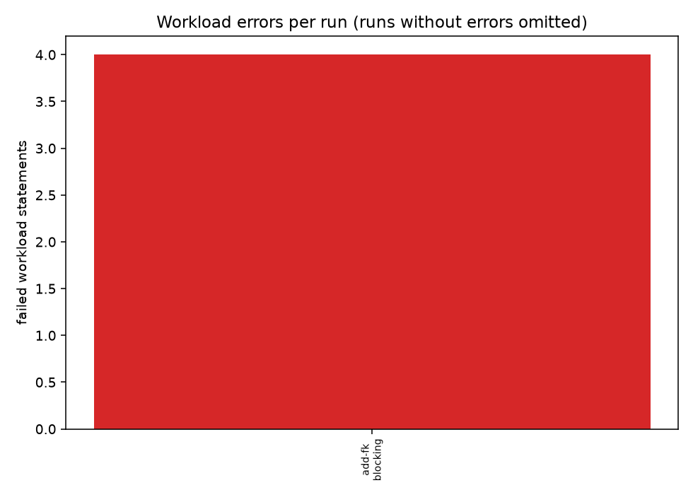

A project for area 8, "Online schema change, without external tools" for the MariaDB student database projects, 2026-09.

# MyLYMB — MariaDB online DDL laboratory

**Recommendation:** Request INSTANT first when supported, then NOCOPY or INPLACE with LOCK=NONE; use COPY with LOCK=NONE when a rebuild is required. Explicit requests prevent silent fallback to a more expensive algorithm. Online does not mean free of metadata locks, I/O costs or replica delay.

## Results at a glance

MariaDB 11.4.13, one million seeded rows, seven changes × seven configurations × five repetitions: **245 requests, 190 successes, 55 expected error-1846 refusals, zero unexpected ALTER failures.** Four workload statements failed in a blocking foreign-key run; DDL success is not application success.

| Change | First request | Five durations (s) | Median (s) | SD (s) |
|---|---|---|---:|---:|
| widen-column-60 | INSTANT | 0.030, 0.022, 0.041, 0.045, 0.043 | 0.041 | 0.010 |
| widen-column-100 | INSTANT | 0.042, 0.033, 0.040, 0.034, 0.037 | 0.037 | 0.004 |
| add-index | NOCOPY | 0.536, 0.559, 0.532, 0.522, 0.530 | 0.532 | 0.014 |
| change-type | COPY / NONE | 6.858, 1.577, 1.591, 1.599, 1.658 | 1.599 | 2.349 |
| widen-column-rebuild | COPY / NONE | 3.756, 3.917, 2.463, 2.497, 3.654 | 3.654 | 0.716 |
| add-fk | COPY / NONE | 6.198, 6.003, 5.964, 6.012, 6.161 | 6.012 | 0.105 |
| add-fk-fkchecks-off | NOCOPY (checks off) | 0.754, 1.345, 0.770, 1.255, 1.335 | 1.255 | 0.303 |

[All 245 raw ALTER records](results/final_20261124_195223/alter_results.csv) · [Classified results](results/final_20261124_195223/analysis/classified_alter_results.csv) · [Statistics](results/final_20261124_195223/repeated_statistics.csv) · [Workload by phase](results/final_20261124_195223/analysis/workload_by_phase.csv) · [Configuration](results/final_20261124_195223/sweep_config.txt) · [Environment](results/final_20261124_195223/environment.json).


Compatible widening to 60 and 100 was about 40× and 66× faster by median with INSTANT than explicit online COPY (1.651 and 2.443 s). This is a duration comparison, not proof of zero blocking. For DATE → DATETIME, 3,196 successful statements overlapped online COPY versus 31 for exclusive COPY across five runs. Overlap includes statements spanning the ALTER boundary, not necessarily completed during it. Four INSERTs failed in one blocking foreign-key run. Short windows with fewer than 30 samples do not support reliable tail percentiles. Online COPY also showed waits in some index and widening runs.



Historical 100k-row console evidence is retained [separately](results/sweep_20261116_145509_console/README.md); its raw workload traces are missing.

## Quick start

Requires Docker Compose v2, Python 3.10+, Bash (Git Bash or WSL on Windows). Use a disposable local database: the harness drops and recreates its tables. Do not point it at production.

```bash
python -m venv .venv
source .venv/bin/activate # Git Bash on Windows: source .venv/Scripts/activate
bash demo.sh
```

The demo generates a local random password, installs dependencies, starts MariaDB 11.4.13 and runs a small repeated comparison. Existing database volumes retain their original passwords; use a fresh lab volume or configure the existing password. Full benchmark: `bash benchmark.sh` (after demo); set ROWS=1000000 for a larger dataset. Results are written to a timestamped folder. Run `python -m pip install -r requirements-dev.txt` and `python -m pytest -q` for unit tests.

## Research question and method

Which ALTER algorithms preserve concurrent write availability, what do they cost, and when does MariaDB refuse them? The sweep resets the schema and seeded data (42), starts writers, observes a workload-only baseline, executes ALTER, then observes recovery. It records individual statements, DDL timing, error codes and processlist samples. The full preset uses five repetitions, four writers and a fixed interval. Record machine and Docker resource limits alongside results; do not generalize one machine to production. See [methodology](docs/methodology.md) and [experiment catalogue](docs/experiments.md).

## Architecture and schema

`reset_db.py` loads `schema.sql` and `generate_data.py`; `workload.py` generates concurrent writes; `run_alter.py` uses the allowlisted registry in `experiments.py`; `sweep.sh` orchestrates runs; `analyze_results.py` produces charts and classifies outcomes. `user_table` uses an integer primary key and utf8mb4 VARCHAR fields to expose storage boundaries; `orders` begins without a foreign key or secondary index so constraint and index construction can be isolated. Both use InnoDB.

## Why MariaDB and where it loses

MariaDB 11.2+ supports native online COPY for supported changes, avoiding external trigger-based migration machinery. Explicit algorithms let operators reject an unsupported migration rather than silently accept a rebuild. But COPY needs temporary space and I/O; metadata locks can delay even INSTANT, and replication can lag. Disabling foreign-key checks trades away existing-data validation. External migration systems may offer operational controls this lab does not evaluate.

The VARCHAR boundary is subtle: utf8mb4 VARCHAR(30) has a maximum of 120 bytes; VARCHAR(50) has 200. Widening to 400 bytes crosses the 255-byte storage boundary in both cases, but the original maximum below 128 bytes can permit INSTANT in cases where the 200-byte original cannot. Test the exact server and row format rather than assuming all widening is instant.

## Extended experiments and limitations

[Raw advanced results](results/final_20261124_195223/advanced.csv) contain 30 probes, three repetitions each. For utf8mb4 VARCHAR widening to 100, starting lengths 30, 31 and 64 succeeded every time; 32, 50 and 63 were refused every time. This isolates the 128-byte original-length threshold and the 255-byte storage boundary.

An open transaction caused INSTANT to time out (error 1205) in 2.0182, 2.0155 and 2.0196 s; after release it succeeded in 22.6, 21.2 and 24.7 ms. This probe measures DDL waiting, not application downtime. With an orphan row, all three validated foreign-key additions failed (1452); all three unchecked additions succeeded and retained the orphan. Never disable validation solely for speed.

The benchmark ran on Windows 11, 20 logical CPUs, a 1 GiB InnoDB buffer pool, four writers, 10 ms configured interval, 10 s baseline and 5 s recovery. RAM, storage type and Docker resource limits were not recorded. The sweep is sequential rather than randomized; cache and background activity can influence timings (e.g. online type-change COPY ranged from 1.577 to 6.858 s). Results describe this machine and workload only. Replication remains unmeasured; see [replication protocol](docs/replication_protocol.md). No replica freshness claim is made.

## Team


| Area | Owner | Main files | Original research items |
|---|---|---|---|
| Infrastructure, progress polling, widen-column | Bashah | `docker-compose.yml`, `schema.sql`, `generate_data.py`, processlist polling in `run_alter.py`, `widen-column-*` | Does INSTANT/NOCOPY work for widening a VARCHAR? |
| `workload.py`, add-index | Leyla | `workload.py`, `add-index` | Does adding an index support NOCOPY; how does it differ from INPLACE? |
| `run_alter.py` skeleton, change-type | Mirqe | `run_alter.py`, `experiments.py`, `change-type` | Widening/changing types (DATE → DATETIME tested) |
| README, sweep script, add-fk | Yasmine | `README.md`, `sweep.sh`, `tests/add-fk/`, `add-fk*` | Does MariaDB support INPLACE/NOCOPY for a foreign key, or force COPY? |


## Further reading

[Original detailed report](docs/original_report.md) · [MariaDB ALTER TABLE](https://mariadb.com/docs/server/reference/sql-statements/data-definition/alter/alter-table) · [Area assignment](https://mariadb.org/bachelor_hackathon_2026-09/)
